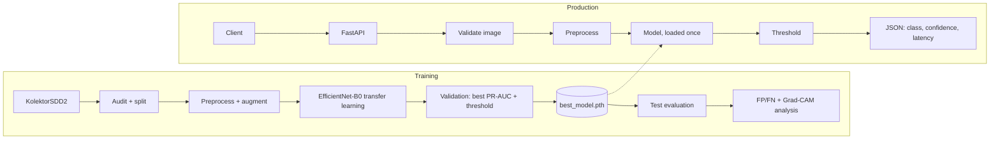

# Visual Defect Inspection — Normal vs Defective

EfficientNet-B0 transfer-learning classifier + FastAPI service that labels a product image **normal** or **defective** and returns a confidence score. Built for the Spark AI Computer Vision Engineer assessment.

> **Dataset note.** The original assessment dataset was not provided, so the public **KolektorSDD2** industrial surface-defect dataset (CC BY-NC-SA 4.0) is used to demonstrate the full end-to-end solution. Results describe that dataset, not the client's data.

## Features
- Dataset audit (counts, sizes, corrupt files, duplicates, defect size) and a reproducible, leakage-safe split (official test set kept untouched)
- EfficientNet-B0 (ImageNet), class-weighted loss, conservative augmentation, near-native 576×208 input
- Decision threshold tuned on validation only (F2, recall-oriented)
- Evaluation: precision / recall / F1 / confusion matrix, FP/FN Grad-CAM examples, measured CPU latency
- FastAPI `/health` + `/predict` with validation, logging, correct status codes and a human-review flag
- Docker (CPU) and tests

## Architecture


## Project structure
```
src/      prepare_data.py dataset.py model.py train.py evaluate.py inference.py metrics.py fill_results.py
api/      main.py                 tests/    test_api.py test_metrics.py
models/   best_model.pth          reports/  metrics.json confusion_matrix.png test_predictions.csv val/
examples/ FP / FN / TP / TN Grad-CAM figures      data/processed/  audit.json splits.csv
Dockerfile  requirements.txt  run_all.ps1  run_all.sh  PROJECT_REPORT.md
```

## Setup
```bash
python -m venv .venv && source .venv/bin/activate      # Windows: .venv\Scripts\Activate.ps1
pip install -r requirements.txt
# Download KolektorSDD2 (https://www.vicos.si/resources/kolektorsdd2/) so you have
#   data/raw/train/<id>.png + <id>_GT.png   and   data/raw/test/<id>.png + <id>_GT.png
python -m src.prepare_data --raw data/raw          # audit + split -> data/processed/
```
**Windows:** run modules as `python -m src.<name>` (not `python src/train.py`) and use `curl.exe` (plain `curl` is a PowerShell alias).

## Training
```bash
# command used for the shipped checkpoint (head-only baseline, CPU, seed 42):
python -m src.train --raw data/raw --batch-size 2 --epochs-head 1 --epochs-ft 0
# full two-phase schedule (head + fine-tune upper blocks) = defaults:
python -m src.train --raw data/raw
# CPU-friendly: all defective images + 4 normal per defective, stop after 150 min, best checkpoint kept:
python -m src.train --raw data/raw --batch-size 4 --epochs-head 2 --epochs-ft 8 --max-normal-ratio 4 --max-minutes 150
```
## Evaluation
```bash
python -m src.evaluate --raw data/raw --split val   # development (writes reports/val, examples/val)
python -m src.evaluate --raw data/raw               # FINAL test evaluation - run once
```

## API
```bash
uvicorn api.main:app --port 8000
curl http://localhost:8000/health
# {"status":"healthy","model_loaded":true}
curl -F "file=@data/raw/test/20012.png" http://localhost:8000/predict
# {"predicted_class":"normal","confidence":0.7858,"defect_probability":0.2142,"threshold":0.58,
#   "review_recommended":false,"latency_ms":397.95}
```
Errors: `400` empty/corrupt/too small · `413` too large · `415` wrong content type · `503` model not loaded. Docs at `/docs`. Tests: `python -m pytest -q`.

## Docker
```bash
docker build -t defect-api .
docker run -d --name defect-api -p 8000:8000 defect-api
```

## Results (official KolektorSDD2 test set: 1004 images, 110 defective)
| Threshold | Precision | Recall | F1 | Accuracy | TP | FN | FP | TN |
|---|---|---|---|---|---|---|---|---|
| 0.50 | 0.789 | 0.682 | 0.732 | 0.945 | 75 | 35 | 20 | 874 |
| **0.58 (shipped, tuned on validation)** | 0.885 | 0.627 | 0.734 | 0.950 | 69 | 41 | 9 | 885 |

ROC-AUC 0.916 · PR-AUC 0.795 · recall 95% CI 53.4–71.2% at 0.58. Always answering "normal" would score 89.0% accuracy, so read recall and precision, not accuracy.
**Speed (CPU, batch 1, incl. preprocessing):** median 55.8 ms, p95 67.2 ms · model 16.34 MB · 10 threads, torch 2.14.1+cpu.


Full analysis, trade-offs and error analysis: [PROJECT_REPORT.md](PROJECT_REPORT.md).

## Known limitations
- Public single-factory dataset (non-commercial licence), not the client's data.
- Image-level classification only (no defect localisation).
- Recall (62.7%) is the main metric to improve; fine-tuning and a time-budgeted training mode are provided for that. Probabilities are not calibrated (`review_recommended` marks borderline cases).
